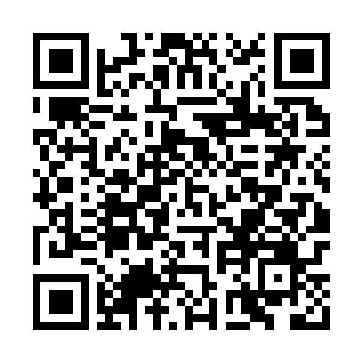

# 邪馬台国マインスイーパー

旧国名（令制国68か国）の地図をマスにしたマインスイーパーです。
女王・卑弥呼は、同盟を結んだ国々にお宝（勾玉・金印・銅鏡・錦・刀・真珠・銅鐸・管玉）を贈りました。
「爆弾」の代わりに隠れているのは、その卑弥呼の同盟国。どの国が同盟国かを見つけ出すゲームです。

## 遊び方

- 国（六角形のマス）をタップすると掘ります。数字（漢数字）は、となりにある同盟国の数です。
- 同盟国だと思う国は、長押し（パソコンは右クリック）か「印をつける」モードで「盟」の印をつけます。
- 数字の国をタップすると、印の数が合っていればまわりを一気に掘れます。
- **同盟国を掘ってしまうと振り出し。** 贈られたお宝を掘り荒らしたことになり、卑弥呼は同盟を結び直して、お宝は別の国へ散らばります。最初からやり直しです（時間はそのまま進みます）。
- 同盟国でない国をすべて掘りきればクリアです。
- 難易度は 易（同盟国6）・中（9）・難（12）の3段階です。

## 音

日本語と英語に対応しています（端末の言語で自動的に切り替わり、タイトル画面でも選べます）。

BGM（笙・琴・龍笛・太鼓風の古代風の曲）と効果音は、Web Audio API でその場で合成しています。音源ファイルは使っていません。
画面右上のボタンでオン・オフを切り替えられます。

## 構成

Web 版は静的ファイルだけで動きます（ビルド不要）。Android 版は Capacitor でアプリにしています。

```
index.html            画面とお宝アイコン（SVG）
style.css             見た目
js/map.js             旧国68か国の配置と隣接関係（英語名も）
js/audio.js           BGM・効果音の合成
js/i18n.js            日本語・英語の文言
js/game.js            ゲーム本体
js/ads.js             AdMob 広告（アプリのときだけ動く）
js/ads-config.js      広告のモード（ビルド時に生成）
js/build-info.js      バージョン表示（ビルド時に生成）
scripts/build-web.js  www/ にまとめる（アプリ用は Web 版だけの部分を取り除く）
android/              Android プロジェクト（Capacitor）
assets/               アイコンと起動画面の元画像
```

ローカルで動かす場合:

```bash
python3 -m http.server 8000
```

## Android アプリ

- パッケージ名：`jp.techgym.himiko`
- 動作確認用 APK（デバッグ署名・テスト広告）：https://github.com/techgymjp/himiko/releases/tag/android-latest
- APK を直接ダウンロード：https://github.com/techgymjp/himiko/releases/latest/download/himiko.apk



`main` に push するたびに GitHub Actions（`.github/workflows/android.yml`）が APK を作り、上のリリース画面の APK を差し替えます。
GitHub Secrets にアップロード鍵（`ANDROID_KEYSTORE_BASE64` など 4 つ）があれば、Google Play 用の署名付き AAB（本番広告）も作り、
Actions の実行結果の Artifacts（`himiko-release-aab`）に置きます。

広告（AdMob）：
- バナー：トップ・あそびかた・ポーズ・結果画面の下だけ（プレイ中は出さない）
- 全画面広告：プレイ開始・トップに戻る・ポーズからの再開・「もう一度」「振り出しから」のたびに
- リワード広告：同盟国を掘ってしまったあと、見ると「掘る前に戻る」ことができる（1 ゲーム 3 回まで）

手元でアプリ用のファイルを作るとき：

```bash
npm ci
```

```bash
npm run android:sync
```

## GitHub Pages で公開

リポジトリの Settings → Pages で、Source を「Deploy from a branch」、Branch を `main` / `/ (root)` にして保存してください。

## ライセンス

著作権はテックジム株式会社に帰属します（All rights reserved）。許可なく複製・改変・再配布すること、
Web サイトやアプリ（Google Play、App Store など）として公開・販売すること、名前・アイコン・画像を使うことを禁止します。
テックジムの受講生が学習目的で複製・改変することは許可します（アプリストアでの公開・広告の掲載・販売などの商用利用は不可）。
詳しくは [LICENSE](LICENSE) を見てください。
